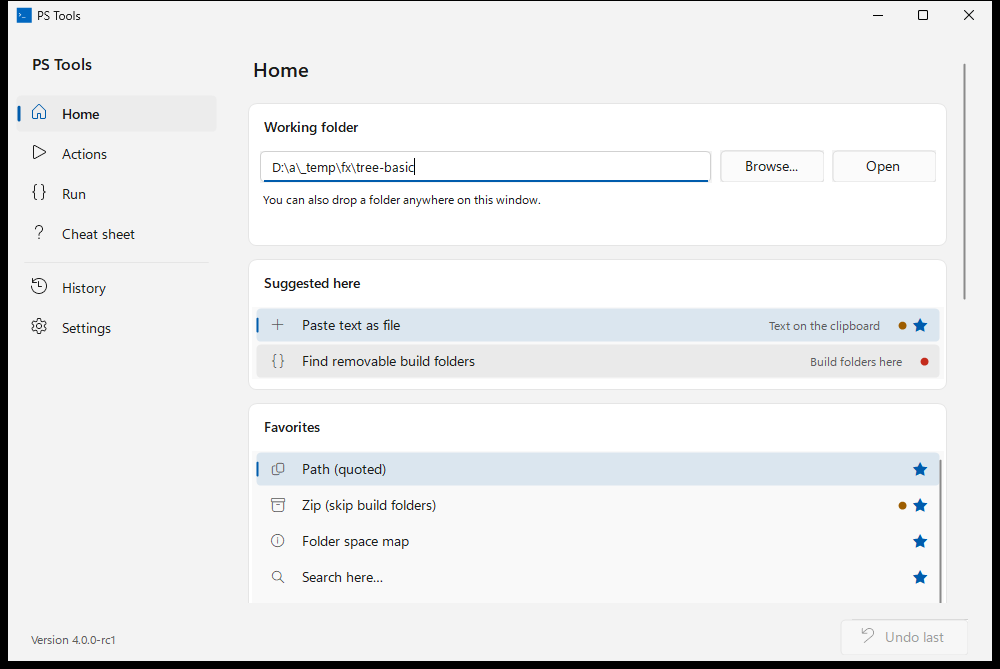
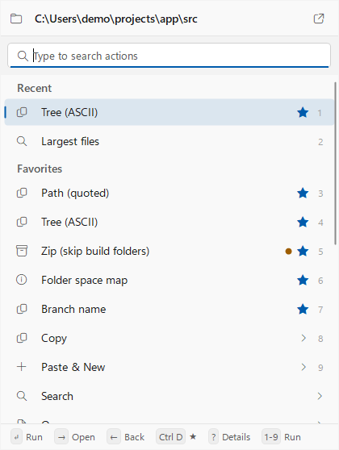
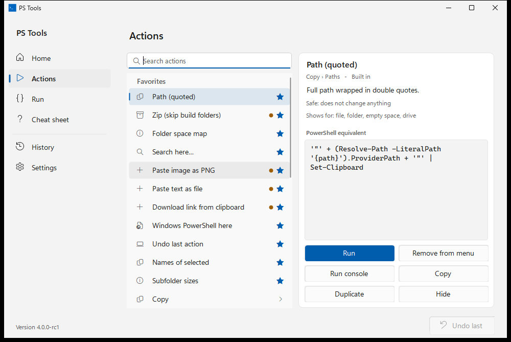
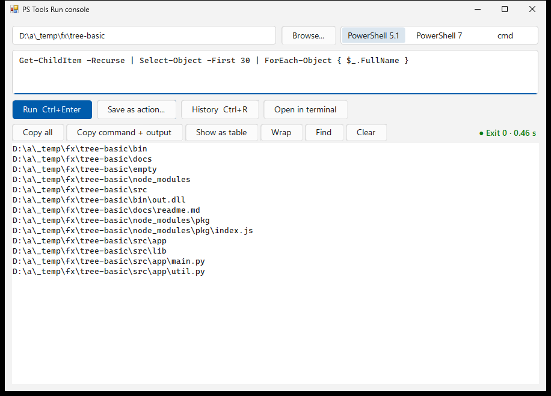
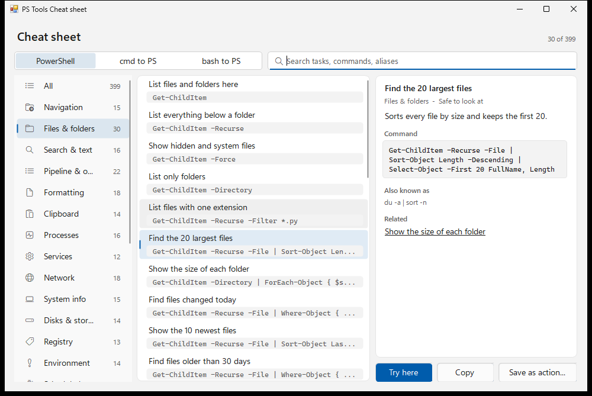
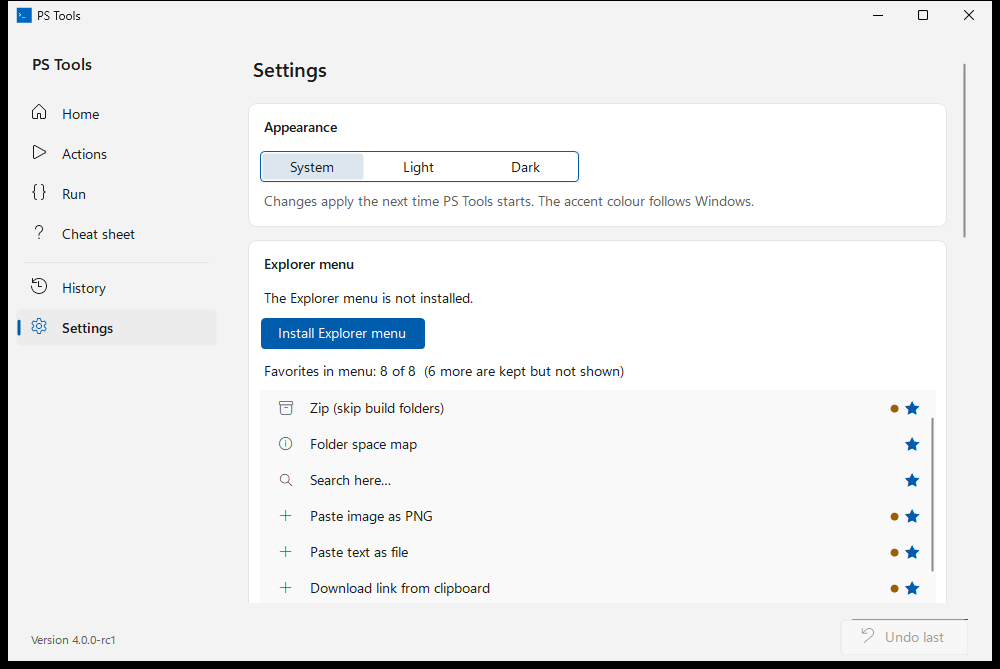

# PS Tools

A small native Windows tool for the folder you are looking at. Right-click, open the PS Tools menu, type two or three letters, press Enter. It also has a console that runs PowerShell, PowerShell 7 or cmd with history and a safety check, a cheat sheet of 400 PowerShell commands written as tasks, and a folder of your own scripts that become menu items.

One `PSTools.exe` (C# and WinForms on the .NET Framework that Windows already has). No installer, no background process, no administrator rights for the app itself.

## The 30-second tour

**Home.** Pick the working folder (type it, Browse, or drop a folder on the window). Home shows what fits that folder, your favorites, what you ran recently, and a short get-started list.



**Power menu.** Right-click in Explorer, open PS Tools, type a few letters, press Enter. Digits 1 to 9 pick a row, `?` shows details, Ctrl+D stars an action, Shift shows rare or risky ones. Inside the app, Ctrl+K opens the same menu.



**Actions.** The whole tree with search and a details card: what the action does, where its result goes, what it changes, and the PowerShell behind it. Run it, star it, copy the command, open it in the Run console, duplicate it as your own, or hide it.



**Run console.** Type any command. Output streams in, Stop ends the whole process tree, Ctrl+R searches history, commands that change files are flagged before they run, and Save as action turns a command into a menu item with the folder filled in for you.



**Cheat sheet.** 399 entries in 25 categories, plus tables that translate cmd and bash commands to PowerShell. Search by what you want to do or by the command you already know: typing `grep` finds Select-String. Try here opens the example in the Run console and never runs it for you.



**Settings.** Theme, the Explorer menu (install, remove, favorites with order, a preview of what Explorer will show), your actions folder with its problems list, Run console options, data and privacy, About.



## Install

Download the zip from the releases page, unzip all of it into one folder and run `PSTools.exe`. `actions.json`, `cheatsheet.json` and `commands.json` must stay next to the exe. The first run shows one screen with two choices: add PS Tools to the Explorer menu, and (Windows 11) switch to the classic right-click menu so entries show without "Show more options". Check the download against `SHA256.txt`.

The exe is not code-signed, so SmartScreen may warn the first time.

## Build (Windows, no SDK)
```
cd app
build.cmd          -> app\out\PSTools.exe, actions.json, cheatsheet.json, commands.json
```
Uses `%WINDIR%\Microsoft.NET\Framework64\v4.0.30319\csc.exe`. The source is C# 5 only: no string interpolation, no `?.`, no expression-bodied members. CI checks this by building with the real compiler.

## Your own actions
Drop a `.ps1`, `.cmd` or `.bat` file into `%LOCALAPPDATA%\PSTools\actions\` (Settings, Actions folder, Open folder). The folder structure is the menu path. A comment header sets the title, where it shows, what it outputs and how risky it is:

```powershell
<#
@title   Git branch name
@menu    Copy/Git
@when    folder, background
@output  clipboard
@risk    safe
@requires git
#>
git -C {dir} rev-parse --abbrev-ref HEAD
```

`{dir}`, `{path}`, `{clip}`, `{input:Label}` and the other placeholders are quoted for you. See [docs/USER_ACTIONS.md](docs/USER_ACTIONS.md) for every key, every placeholder and ten copy-paste examples. A bad file is skipped and listed under Settings, Actions folder, Problems.

## Safety
Each action has a risk level. Safe ones run at once. Ones that change files ask once and, for the built-in file actions, can be undone (**Undo last** or **Undo history**). Destructive ones always ask and show the exact script; Undo does not cover scripts. The Run console classifies what you type the same way and asks before running anything that changes files (turn that off in Settings, Run console). Everything in `actions.json`, `cheatsheet.json` and the built-in scripts is parsed with Windows PowerShell 5.1 in CI, and every cheat sheet entry marked safe is executed there.

## Command line
```
PSTools.exe                         open the window
PSTools.exe open "<folder>"         open the window on a folder
PSTools.exe run "<folder>"          open the Run console in a folder
PSTools.exe cheatsheet "<folder>"   open the Cheat sheet (--query text to start a search)
PSTools.exe menu "<path>"           the Power menu for an item (what the Explorer entry runs)
PSTools.exe menu-bg "<folder>"      the Power menu for empty space in a folder
PSTools.exe <action-id> "<path>"    run one action
PSTools.exe --install | --uninstall | --repair | --status
PSTools.exe --list-actions [--json]
PSTools.exe --dump-menu | --dump-tree | --dump-snippets
PSTools.exe --risk-classify-json <file>   classify commands as safe, modifies or destructive
PSTools.exe --selftest              internal checks, exit code 0 when all pass
```

## Footprint and clean uninstall
Writes only:
- `HKCU\Software\Classes\Directory\shell\PSTools`, `...\Directory\Background\shell\PSTools`, `...\Drive\shell\PSTools`, `...\*\shell\PSTools`
- `%LOCALAPPDATA%\PSTools\` (settings, run history, undo data, your actions folder, temporary files)
- only if you use them: the Explorer hidden-files and extensions values and the classic-menu key, tracked in `changes.txt` and restored by Full uninstall

Settings, Remove Explorer menu removes only the menu. Full uninstall (or `--uninstall`) also removes the data folder and restores the Windows settings PS Tools changed. `PSTools.exe` itself stays until you delete it. If you move the exe, starting it from the new place repairs the menu entries, or run `--repair`. `app\tools\footprint-check.ps1` proves this on a machine: it snapshots, installs, runs an action, uninstalls and fails if anything differs.

## Coming from v3
First start migrates your settings and keeps a backup next to them. Your pinned items become favorites, recipes and undo history are untouched, and every v3 action id still works on the command line. The old presets and the separate menu preview window are gone; Settings shows a preview of the menu instead.

## Testing
CI (`.github/workflows/ci.yml`) builds with the real compiler on `windows-latest` and runs: the self-test, the action tests with golden files and undo checks, a parse of every command with Windows PowerShell 5.1, the cheat sheet check, a check that the example actions load, the footprint check, UI Automation scenarios (including a keyboard-only tour) and light and dark screenshots at 100% and 150% with a pixel lint and a diff against `app/tests/ui/baseline`. The UI gallery for each pull request is posted as a comment.

## Project layout
```
app/src/            the program (Program.cs entry, MainWindow.cs, HomePage.cs, ActionsPage.cs, SettingsPage.cs,
                    PowerMenu.cs, RunForm.cs, CheatSheetForm.cs, ActionCatalog.cs, Executor.cs, Shell.cs, Settings.cs ...)
app/actions.json    actions that ship as data
app/cheatsheet.json the cheat sheet
app/commands.json   the command library
app/tests/          check scripts and fixtures, UI scenarios and baselines
app/tools/          footprint, layout and snippet checks
docs/               USER_ACTIONS.md, examples, v4 planning documents and FINDINGS.md
```
